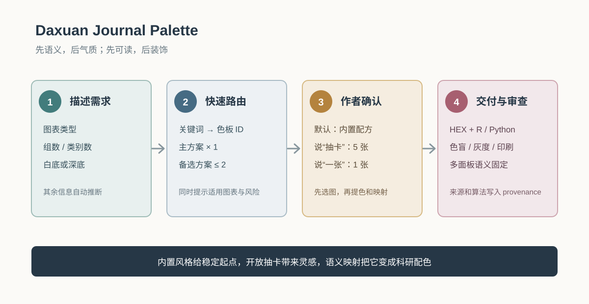
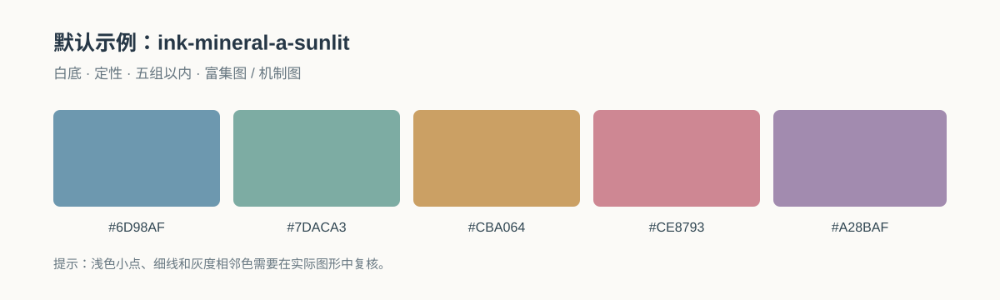

# Daxuan Journal Palette

一个面向科研论文图表的配色 Skill：把图表语义、作者审美和出版可读性连接起来，输出可复用的 HEX、R/ggplot2、Python 映射以及色盲、灰度、印刷和多面板一致性审查。当前版本为 0.7.0。

## 这个 Skill 的亮点：抽卡式找到配色

很多科研作者并不是缺少配色规则，而是不知道自己喜欢的感觉该怎么描述：想要克制一点、东方一点、像矿物或纸本一点，却很难直接写出一组 HEX。这个 Skill 允许你从一句模糊的审美感受开始，不要求先成为配色专家。

它有两条可以互相接上的灵感入口：

| 灵感入口 | 你会得到什么 | 适合什么时候用 |
|---|---|---|
| **内置艺术风格库** | 水墨、青瓷、敦煌矿物、青花、草木土色、现代编辑部等整理好的科研配方 | 想快速开始，或希望同一项目长期复用 |
| **开放图片抽卡** | 从公共领域或开放授权的艺术图片中随机抽 3–10 张，先选一张，再提取和调整配色；要求多彩时自动筛掉灰度/低饱和候选 | 没有明确方向，想获得意外灵感，或想建立自己的新风格 |

抽卡不是把图片颜色直接贴到论文图上。图片负责打开想象，作者选中的视觉线索再经过提色、语义映射和科研图示例，变成可以解释、复用和继续维护的色板。默认抽 5 张；说“随机一张”时只返回 1 张；显式说“抽十张”时返回 10 张。要求色彩丰富时，流程会先用缩略图筛掉主要为灰度或低饱和的候选。抽卡来源、作品信息、提色方法和调整记录会保存在 `provenance` 中。

一句话理解它：**内置风格给你稳定起点，开放抽卡给你创造力，科研语义把灵感变成可用配色。**

## SCI 配色库适配

本 Skill 还可以调用本机 `sci-color-palettes`：Daxuan 负责视觉风格、语义映射和实际图形；SCI 配色库负责 184 套候选方案的临床/数据库/基础科研应用档案，以及 CVD、明度跨度和对比度诊断。两者通过 [`scripts/sci_palette_bridge.py`](scripts/sci_palette_bridge.py) 连接，不复制或混合两套注册表。

对于当前久坐—心血管环形热图，适配器把颜色拆成三个独立语义层：5 类结局使用分类色板，signed LDSC 使用 `div-*` 发散色带，HDL/Genova 验证状态使用中性灰 + 单一强调色。每一层保持自己的顺序和审计记录，不能从不同色板中拼出新的类别序列。

```bash
python3 scripts/sci_palette_bridge.py --figure circular --groups 5
```

用户的视觉反馈可以直接变成可复查的约束。例如，拒绝绿色正相关端、要求轻盈白底、同时保留黄橄榄线索：

```bash
python3 scripts/sci_palette_bridge.py \
  --figure circular --groups 5 --avoid-hue green \
  --lightness-target airy --chroma-target moderate \
  --preserve-cue yellow/olive
```

如果本机没有安装可选的 `sci-color-palettes`，命令会返回 `sci_status: unavailable` 和 `fallback: daxuan-atlas`，不会让 Daxuan 的基础路由失效。显式传入 `--sci-root` 时，路径错误会直接报告，避免静默使用另一份色板库。

### 真实预览卡

色板不能只看 HEX。用同一组颜色生成正常视觉、灰度、protanopia、deuteranopia 和目标尺寸五联预览：

```bash
python3 scripts/render_palette_preview.py \
  --title "circular LDSC category ring" \
  --colors '#6D98AF' '#7DACA3' '#CBA064' '#CE8793' '#A28BAF' \
  --output-dir /tmp/daxuan-palette-preview
```

脚本输出 `palette_preview.png` 和 `palette_preview.json`。它是最终图形前的筛查卡，不是期刊或色盲认证；环形图仍需在目标尺寸的 PNG/PDF/SVG 上复查。

## 人机协同审阅

Skill 会先给出 1 套主方案和最多 2 套备选，再询问作者三个有限方向：

1. 保持当前气质，还是更轻盈、更鲜明、更暖或更冷静；
2. 这一轮优先均衡、可读性、审美，还是打印/CVD；
3. 只改配色，还是允许同步改图例或整图细节。

作者选择前状态保持为 `awaiting_author`，生产图不会被修改。选择或自由文本反馈会被保存为 `preference_constraints`，并在下一轮渲染中复用。

```bash
python3 scripts/author_review.py create \
  --request "改进当前 LDSC 环形热图配色" \
  --candidate ink-mineral-a-sunlit \
  --candidate div-plum-blue \
  --figure-type circular --groups 5 \
  --output qa/author-review.json

python3 scripts/author_review.py record \
  --brief qa/author-review.json \
  --selection ink-mineral-a-sunlit \
  --answer priority=readability \
  --feedback "不要绿色，太暗，希望更丰富" \
  --output qa/author-review-round-2.json
```

这套流程把作者审美保留为决策输入，把机器检查保留为证据输入；数据、统计语义和几何不会因为一次颜色反馈被悄悄改动。完整协议见 [`references/human-review-protocol.md`](references/human-review-protocol.md)。

完整的字段映射、调用规则和输出契约见 [`references/sci-color-palettes-bridge.md`](references/sci-color-palettes-bridge.md)。

## 联合抽卡：10 张视觉卡片 × SCI 候选

如果你希望“先抽卡找气质，再得到适合论文图的语义色板”，运行 [`scripts/joint_palette_draw.py`](scripts/joint_palette_draw.py)。它把本地 10 张高清卡片和 SCI 候选放到同一张预览中：卡片提供视觉线索，SCI ramp 负责分类块、发散热图或环形热图的最终语义。两者通过 CIE76 匹配距离建立对应关系，但不会跨语义拼色。

```bash
python3 scripts/joint_palette_draw.py \
  --cards-json /path/to/colorful_cards_v2_with_palettes.json \
  --figure all --groups 5 --draw-count 10 \
  --seed 20261025 --output-dir qa/joint_palette_draw
```

输出 `joint_palette_draw.json`、`joint_palette_preview.png` 和 `index.html`。`categorical` 对应分类色块，`heatmap` 对应带零点的发散热图，`circular` 同时拆分分类环、热图环和中性验证环；完整规则见 [`references/joint-card-sci-workflow.md`](references/joint-card-sci-workflow.md)。

图片提色或 Daxuan 内置配方也可通过 `audit_hex([...])` 复用 SCI 的 CVD、ΔE、明度跨度和白底对比度诊断，而不需要把候选色注册进 SCI 色板库。

## Prerequisites

- [ ] Python 3.10+（仅用于生成静态画廊）
- [ ] Pillow（仅在需要从本地图像自动提色时需要；可改用人工取色）
- [ ] R 或 Python 绘图环境（仅在实际绘图时需要）
- [ ] 不需要先知道 HEX 或配色规则；能说出图表类型、组数或大致感觉就可以开始

开放公共领域抽卡需要网络；内置色板、静态画廊和生成式卡片提示不依赖网络。

## 30 秒开始



你可以从一句模糊的感觉开始，也可以只提供三个信息：**图表类型、组数/类别数、白底或深底**。普通请求先得到 1 套主方案和最多 2 套备选；明确说“抽卡”或“从图片提色”时，才进入开放图片流程。

| 你的困境或目标 | 直接这样说 | 默认行为 |
|---|---|---|
| 不知道该怎么选色 | “我没有明确配色，抽 5 张适合白底论文图的公共领域作品” | 抽 5 张，先选图再提色 |
| 快速得到稳定方案 | “五组白底 GO 富集图，东方水墨风格” | 内置路由，返回 1+2 套方案 |
| 比较几种审美 | “比较宋韵、敦煌和北欧矿物，适合白底多面板” | 先比较风格，再给主方案 |
| 开放探索 | “随机抽 5 张色彩丰富的蓝绿色公共领域作品” | 开启色彩丰富度筛选，从开放来源抽卡，保留来源记录 |
| 只看一个灵感 | “随机一张现代水墨视觉卡片” | 只生成/返回 1 张 |
| 审查已有配色 | “审查这张热图的连续色带和灰度风险” | 保留数据语义，检查可读性 |
| 颜色好看但组间读不清 | “保留这种气质，拉开五组颜色的明度和灰度差异” | 同一家族内优先修正明度 |
| 不同分面中的同一通路变了颜色 | “固定所有分面中同一通路的颜色，并给我 R/Python 映射” | 建立全局语义映射 |

### 默认白底示例



这套 `ink-mineral-a-sunlit` 是白底五组以内的默认起点。它不是期刊官方色板，也不是历史颜色复原；最终仍需结合图形尺寸、灰度和输出介质审查。

## 你可以直接这样说

- “给 GO-BP 富集图设计中国水墨加矿物色，输出 HEX 和 ggplot2 映射。”
- “给五组科研柱状图选不太浅、适合期刊投稿的高级配色，检查色盲和灰度。”
- “比较宋韵、敦煌矿物和北欧矿物三种论文配色，告诉我哪一种适合白底多面板图。”
- “把水墨、文人纸本、青花瓷、草木土色、海岸矿物和现代编辑部风格列成风格地图，给出适用图形和风险。”
- “审查这张热图的连续色带和中点设置，给出印刷和最终尺寸风险。”
- “把所有分面中同一通路固定为同一种颜色，并生成 R 和 Python 代码。”
- “在内置风格之外，随机抽 5 张公共领域的蓝绿色作品，让我选一张，再提取配色做 GO 富集图。”
- “生成 5 张没有文字的现代水墨视觉卡片，我选一张后，把它转成适合白底论文图的 5 色方案。”

## 输出

输出不是一串孤立的 HEX，而是把一条审美线索变成科研可用方案：每套方案会说明灵感来自哪里、适合什么图表语义、颜色如何分配，以及如何继续在 R/ggplot2 和 Python 中复用。默认给一套主方案和不超过两套备选方案；可读性检查放在实际图形之后，不会挡住最初的创意探索。风格总表见 [references/style-taxonomy.md](references/style-taxonomy.md)，具体配方见 [references/palette-atlas.md](references/palette-atlas.md)。需要直观看颜色时，打开 [assets/palette-gallery/index.html](assets/palette-gallery/index.html) 或 [assets/palette-gallery/palette-atlas.svg](assets/palette-gallery/palette-atlas.svg)。

当前用户选定的 A 风格经过白底和缩印优化，默认使用 `ink-mineral-a-sunlit`：

```text
#6D98AF  #7DACA3  #CBA064  #CE8793  #A28BAF
```

它适合白底的富集图、机制图和五组以内的定性分类。它是设计色板，不是历史色彩复原；较深的 `ink-mineral-a` 仍可用于深色底图或需要更强重量感的图。

快速路由只读取轻量索引；完整 HEX 配方、艺术来源和审查细节按需展开。命令行可以用 `--compact` 获取简短结果，用 `--limit 1` 只保留主方案：

```bash
python3 scripts/route_palette.py "五组白底 GO 富集图，东方水墨风格" --compact
```

典型的紧凑结果是：

```text
模式：fast-built-in
主方案：ink-mineral-a-sunlit
备选：dunhuang-mineral、hokusai-indigo
类型：qualitative；组数：5；背景：white
下一步只需确认：图表类型、组数、白底/深底
```

可用的艺术家族包括：水墨矿物、文人纸本、江南烟雨、宋韵青瓷、青花瓷、敦煌矿物、朱砂宫墙、草木土色、茶褐植物、北欧矿物、海岸矿物、沙漠陶土、高山湖泊、现代编辑部、临床冷暖、石墨铜色、单色强调、柔和补充图，以及印象派大气、梵高式强调、马蒂斯式平面、Rothko 式色域、浮世绘靛蓝和现代水墨矿物。它们是视觉设计标签，不代表任何期刊官方色板或历史色彩复原。艺术来源和公开仓库见 [references/artistic-inspiration.md](references/artistic-inspiration.md)。

画廊由 [scripts/build_palette_gallery.py](scripts/build_palette_gallery.py) 从 `palettes.json` 生成。HTML 用于筛选和复制，SVG 用于矢量查看，CSV 用于 R/Python 整理；灰度代理仅用于快速发现明度风险。

如果你想让灵感更开放，可以使用 [开放抽卡工作流](references/card-draw-workflow.md)：用 [scripts/draw_art_cards.py](scripts/draw_art_cards.py) 从公共领域候选图中抽卡；当要求“色彩丰富”时加 `--palette-friendly`，必要时用 `|` 连接多个主题扩大候选池，再用 [scripts/extract_palette.py](scripts/extract_palette.py) 提取候选色，或调用本机 `imagegen` 生成 3–5 张视觉卡片。必须先让作者选图，再做语义映射和实际图形审查；抽卡来源、生成 prompt、版权状态、色彩筛选和提色方法都要进入 `provenance`。

普通请求先走 [快速路由索引](assets/palette-gallery/palette-index.json)，使用 `scripts/route_palette.py` 返回 1 套主方案和最多 2 套备选；只有用户明确提出抽卡或图片提色时才进入图像流程。默认只追问图表类型、组数和白底/深底。

快速路由示例：

```bash
python3 scripts/route_palette.py "五组白底 GO 富集图，东方水墨风格"
python3 scripts/route_palette.py "随机抽一张蓝绿色公共领域作品"
```

仓库包含 MIT LICENSE 和 GitHub Actions 校验，可作为 public GitHub skill 发布；具体发布和版本标签顺序见 [references/github-publishing.md](references/github-publishing.md)。

## 图片、画廊与公开来源

| 资源 | 用途 |
|---|---|
| [快速使用流程图](assets/quickstart/usage-flow.svg) | 查看“需求 → 路由 → 确认 → 交付”的基本理念 |
| [默认白底色板图](assets/quickstart/default-palette.svg) | 直观看到默认五色，而不是只看 HEX |
| [交互式画廊](assets/palette-gallery/index.html) | 按风格、图表类型和关键词筛选，复制色板 ID |
| [SVG 色板总览](assets/palette-gallery/palette-atlas.svg) | 适合浏览、打印和矢量编辑 |
| [CSV 色板表](assets/palette-gallery/palettes.csv) | 供 R/Python 或表格工具继续整理 |
| [快速路由索引](assets/palette-gallery/palette-index.json) | 查看关键词、色板 ID、适用图表和风险 |
| [艺术灵感与公开仓库](references/artistic-inspiration.md) | MetBrewer、scico、accessible-color-cycles、PNWColors 等 |
| [开放抽卡工作流](references/card-draw-workflow.md) | 公共领域、生成式和混合抽卡的完整步骤 |
| [联合抽卡工作流](references/joint-card-sci-workflow.md) | 视觉卡片与 SCI 语义候选的匹配、审计和联合预览 |
| [环形图五联预览卡](assets/showcase/circular-palette-preview/palette_preview.png) | 当前 LDSC 环形图分类环的正常视觉、灰度、CVD 与目标尺寸筛查 |
| [人机协同审阅协议](references/human-review-protocol.md) | 作者选择、暂停点、反馈转约束和决策日志 |

可进一步浏览的公开来源：[The Met Open Access API](https://metmuseum.github.io/)、[National Gallery of Art Open Access](https://www.nga.gov/artworks/free-images-and-open-access)、[Rijksmuseum Data Services](https://data.rijksmuseum.nl/)、[Art Institute of Chicago API](https://api.artic.edu/docs/)、[Color for geoscience](https://dominicroye.github.io/color-for-geoscience/) 和 [SciPalette](https://scipalette.fantasticjoe.com/)。使用外部图像时，保留对象页、权利状态、提色算法和调整记录。

## 使用边界

本 Skill 负责色彩方案和图形可读性审查，不负责统计检验、数据清洗、期刊投稿保证、品牌识别、网页 UI 主题或照片调色。色盲/灰度检查只能说明当前图形在给定尺寸和导出格式下的风险，不能替代人工查看。

可选地结合本机 `easyplot` 的 palette audit、`nature-figure` 的图形契约、`journal-ggplot-stylebook` 的期刊导出规则和 `sci-color-palettes` 的应用档案；这些依赖不由本 Skill 自动安装。自动诊断只能提供当前图形的风险信号，不能证明色盲认证、印刷无风险或期刊接受。

## 本地验证

本地目录可直接被 Codex 读取；需要用 Skills CLI 安装到另一个环境时，可使用 npx skills add /home/daxuan/.codex/skills/daxuan-journal-palette，再按目标环境的安装提示确认目录。

上游参考：qiaomu-meta-skill; K-Dense-AI/scientific-agent-skills scientific-visualization; local easyplot; local nature-figure; local journal-ggplot-stylebook; local sci-color-palettes。

```bash
python3 /home/daxuan/.codex/skills/qiaomu-meta-skill/scripts/validate_skill.py /home/daxuan/.codex/skills/daxuan-journal-palette
python3 /home/daxuan/.codex/skills/qiaomu-meta-skill/scripts/trigger_eval.py /home/daxuan/.codex/skills/daxuan-journal-palette --output /home/daxuan/.codex/skills/daxuan-journal-palette/reports/trigger-eval.json
```

## Troubleshooting

- 颜色太浅：先保留色相，降低 LCH/OKLCH 明度；同步增加填充描边和文字对比，不要只把所有颜色变成黑色。
- 分类过多：改用直接标签、形状或分面；不要继续添加相近的浅色。
- 灰度下难以区分：用明度层次重排，并补充线型、形状或标签。
- 热图中点不明确：使用发散色带并明确中点的统计含义；没有有意义的中点时改用连续色带。
- 多面板颜色漂移：建立一个全局命名映射，在每个面板中按同一键值调用。

## 关于大轩

本项目由大轩维护，面向科研绘图、组学分析和可复用的 AI 科研工作流。

- GitHub: [DaXuanGarden](https://github.com/DaXuanGarden)
- GitLab: [DaXuanGarden](https://gitlab.com/DaXuanGarden)
- 微信公众号: 大轩的成长花园

### 关注公众号

扫描下方二维码，或在微信中搜索「大轩的成长花园」：

<p></p>

<!-- qiaomu-profile:start -->
## 关于向阳乔木

向阳乔木（乔向阳 / Joe）是一位实践型 AI 产品与内容创作者，长期把前沿 AI 变化转译成可复用的工作流、产品判断、AI 编程实践、AI 搜索实践和 GEO/AI 营销方法。

- 个人网站: https://qiaomu.ai
- 博客: https://blog.qiaomu.ai
- X: https://x.com/vista8
- GitHub: https://github.com/joeseesun/
- 微信公众号: 向阳乔木推荐看

### 支持与关注

| 打赏支持 | 微信公众号 |
|---|---|
|  |  |
| 感谢支持乔木持续分享 AI 实践 | 扫码关注「向阳乔木推荐看」 |

<!-- qiaomu-profile:end -->

## License

MIT. See [LICENSE](LICENSE).

Copyright (c) 大轩  
GitHub: https://github.com/DaXuanGarden
